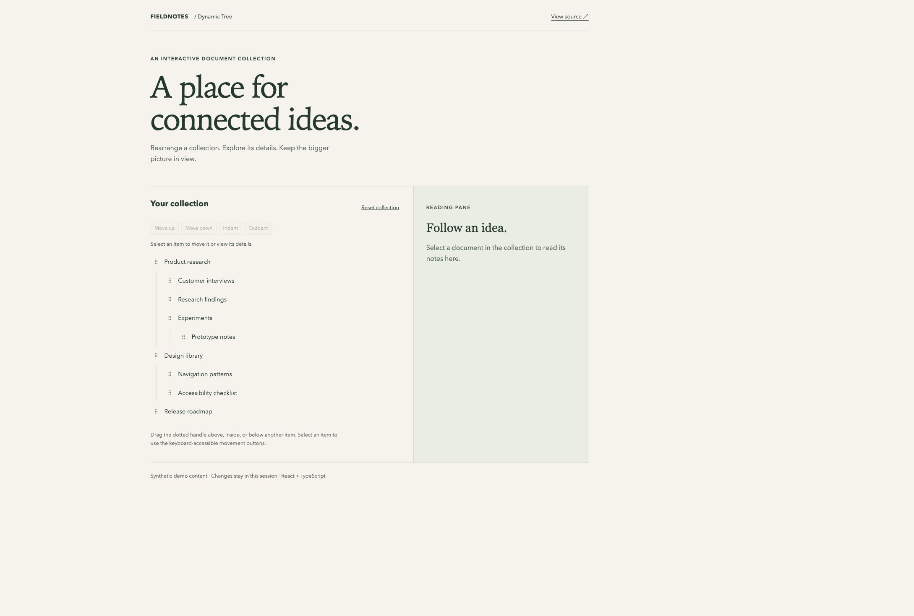

# Dynamic Tree

[](https://github.com/kaprielov/dynamic-tree/actions/workflows/ci.yml)

A React + TypeScript document collection with nested drag-and-drop, a reading pane,
and keyboard-accessible movement controls. Originally built as a frontend take-home
exercise; this version uses bundled synthetic content for a standalone demo.

**[Open the demo](https://kaprielov.github.io/dynamic-tree/)** · [Browse the code](src)



## Try it

- Select a document to read its details.
- Drag the dotted handle to place an item above, inside, or below another item.
- With a keyboard, Tab to an item and press Enter to select it. Tab to **Move up**,
  **Move down**, **Indent**, or **Outdent** to rearrange it without dragging.
- **Reset collection** restores the original example. Refreshing also resets changes.

## Run locally

Requires Node.js 22.13+ and npm. No account, API key, or backend is needed.

```sh
npm ci
npm run dev
```

```sh
npm test
npm run build
npm run lint
```

CI runs the same commands on Linux and deploys the static build to GitHub Pages.

## Design decisions

| Concern                      | Approach                                                                                                                                                               |
| ---------------------------- | ---------------------------------------------------------------------------------------------------------------------------------------------------------------------- |
| Stable identity during moves | Each node receives an element ID independent of its document ID and position.                                                                                          |
| Safe hierarchy changes       | Tree operations preserve the source structure; drag validation prevents moving a node into itself or its descendants.                                                  |
| Input alternatives           | Pointer dragging has explicit drop indicators; ordinary focusable buttons offer sibling moves and reparenting. This is a nested list, not a complete ARIA tree widget. |
| Repeatable demo              | Synthetic documents are bundled locally; the original exercise's external data service is no longer required.                                                          |
| Small application state      | React state and pure tree functions; no global state library for the current scope.                                                                                    |

Start with [the page](src/pages/App.tsx), [drag handlers](src/components/Tree/treeDragHandlers.ts),
[tree operations](src/utils/index.ts), and [button-driven movement](src/utils/moveNode.ts).
Tests cover hierarchy operations and a page flow through selection, reparenting,
and reset.

## Scope

This is a frontend demonstration: no persistence, backend, or collaboration.
All branches are expanded. The collection is intentionally small and is not virtualized.
The movement buttons provide a keyboard alternative; comprehensive assistive-technology
and touch-device testing remains future work.
